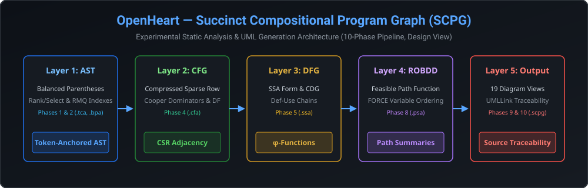

<div align="center">

# OpenHeart

### Succinct Compositional Program Graph (SCPG) Engine & UML Diagram Studio

[](Cargo.toml)
[](LICENSE)
[](https://ahmadhassan-bted.github.io/OpenHeart/)
[](https://github.com/AhmadHassan-BTed/OpenHeart/actions/workflows/ci.yml)
[](docs/status.md)
[-blueviolet.svg?style=flat-square)](https://github.com/AhmadHassan-BTed)

<br/>

<p align="center">
  <a href="https://trendshift.io/repositories/276412?utm_source=trendshift-badge&amp;utm_medium=badge&amp;utm_campaign=badge-trendshift-276412">
    
  </a>
    <a href="https://trendshift.io/repositories/276412?utm_source=trendshift-badge&amp;utm_medium=badge&amp;utm_campaign=badge-trendshift-276412">
    
  </a>
  <a href="https://trendshift.io/repositories/276412?utm_source=trendshift-badge&amp;utm_medium=badge&amp;utm_campaign=badge-trendshift-276412">
    
  </a>
</p>

<p align="center">
  
</p>

<p align="center">
  An experimental static program-analysis engine for Java: a ten-phase Rust pipeline from tree-sitter ingestion to symbol tables, control-flow and SSA form, call graphs, path summaries and UML diagrams, with a browser-based diagram studio.
</p>

</div>

---

## Project Status

OpenHeart is **experimental research software**. The pipeline runs end to end on Java sources, but several analyses are partial, and several diagram views are still templates whose content does not depend on the analysed program. Before relying on any output, read **[Implementation Status, Support Matrix & Claims Ledger](docs/status.md)**. That page is the source of truth for what the code does, and it records every earlier headline claim that has been withdrawn (including "128× memory compression", "F1 = 1.0000 across six languages", "zero-copy memory mapping", IFDS, Andersen points-to and Rudell sifting).

| Area | State |
|---|---|
| Languages | **Java** only (Tier 1, experimental). Only the Java and JavaScript tree-sitter grammars are linked, and only Java has adapters for every phase. No other language — Kotlin included — is supported; see the [language support matrix](docs/status.md#2-language-support-matrix). |
| Accuracy | No independent accuracy benchmark exists yet. Any future number must follow the [measurement protocol](docs/status.md#7-measurement-protocol). |
| Space and speed | Not measured. No space or speed figure is claimed until the benchmark suites in the measurement protocol report one. |
| Diagrams | Some views are derived from the analysed program and others are templates or not yet derived; the [diagram provenance matrix](docs/status.md#5-diagram-provenance-matrix) records which. |

Status tables in this README and in `docs/status.md` record the code as audited at commit `fc218cd`. An entry changes only in the change that fixes it, with links to the module and to a test that asserts an expected result.

---

## System Overview

OpenHeart is built around a design called the **Succinct Compositional Program Graph (SCPG)**, a 7-tuple graph model

$$\mathcal{G} = (V, E, \nu, \varepsilon, \tau, \rho, \Sigma_\Phi)$$

that layers lexical tokens, a Balanced Parentheses (BP) AST, Compressed Sparse Row (CSR) control-flow graphs, Static Single-Assignment (SSA) data flow, call graphs and Reduced Ordered Binary Decision Diagram (ROBDD) path summaries over one monotonic `token_id` traceability anchor. The formal model, its intended complexity bounds and the research paper describe the **design target**; [docs/status.md](docs/status.md) describes how far the reference implementation has reached it.

Designed, created, and maintained by **Ahmad Hassan (B-Ted)**.

---

## What the Code Does Today

- **Java ingestion** with tree-sitter and `tree-sitter-java`: monotonic 32-bit `token_id` anchors, an FNV-1a string interner and 16-byte token records in a `.tca` artifact with a CRC-64/ECMA trailer.
- **BP-encoded AST** (`.bpa`) with rank/select-based navigation indexes.
- **Symbol table and type hierarchy** (`.sta`) built in five passes over the AST.
- **Per-function CFGs** in CSR form with Cooper et al. dominators and dominance frontiers (`.cfa`), and SSA construction modules (`.ssa`).
- **Call graph** (`.cga`) from call sites with Class Hierarchy Analysis dispatch.
- **Traceability index** (`.tra`): O(1) entity-to-source lookups through dense backward arrays, and sorted span records for source-to-entity queries.
- **ROBDD path summaries** (`.psa`). Check the [phase capability ledger](docs/status.md#4-phase-capability-ledger) before relying on path counts: at the audited baseline they overstated the number of paths of branching functions.
- **Diagram export** to PlantUML, Mermaid and JSON for the 19 view types listed below.
- **Declarative studio manifest**: `web/diagrams/manifest.json` defines the 3 categories, 19 diagram types, 16 relationship kinds and 24 node kinds that the web studio renders.
- **Web studio** on GitHub Pages. It does **not** run the Rust engine: it uses a JavaScript heuristic extractor over a sample of a repository's files. Full analysis requires the native engine (`openheart server`).

---

## Diagram Suite (19 View Types)

Each view type has an exporter. The **Status** column states whether its content was computed from the analysed program at the audited baseline; the full matrix with reasons is in [docs/status.md §5](docs/status.md#5-diagram-provenance-matrix).

### 1. UML Structural Views (7)

| # | View | Studio layout | Status |
|---|---|---|---|
| 01 | Class Diagram | `package_tree` | Partial — derived from symbols and type-hierarchy edges |
| 02 | Package Diagram | `hierarchical` | Partial — containment only, no dependency edges |
| 03 | Component Diagram | `hierarchical` | Partial — one component per package |
| 04 | Composite Structure Diagram | `hierarchical` | Not derived — extractor is empty |
| 05 | Object Diagram | `hierarchical` | Not derived |
| 06 | Deployment Diagram | `hierarchical` | Partial — package view, no deployment metadata |
| 07 | Profile Diagram | `hierarchical` | Template |

### 2. UML Behavioral Views (7)

| # | View | Studio layout | Status |
|---|---|---|---|
| 08 | Sequence Diagram | `sequence` | Partial — no fragments or nesting; scenarios merged |
| 09 | State Machine Diagram | `hierarchical` | Template |
| 10 | Activity Diagram | `hierarchical` | Partial — CFG blocks without guards or labels |
| 11 | Use Case Diagram | `usecase` | Partial — heuristic actor detection |
| 12 | Communication Diagram | `hierarchical` | Not derived — extractor is empty |
| 13 | Interaction Overview Diagram | `hierarchical` | Not derived |
| 14 | Timing Diagram | `timing` | Template — illustrative clock |

### 3. Compiler IR Views (5)

| # | View | Studio layout | Status |
|---|---|---|---|
| 15 | Control Flow Graph (CFG) | `hierarchical` | Template — exporters do not yet read `.cfa` |
| 16 | Data Flow Graph (DFG) | `hierarchical` | Template — exporters do not yet read `.ssa` |
| 17 | Control Dependence Graph (CDG) | `hierarchical` | Template |
| 18 | Call Graph (CG) | `hierarchical` | Template — exporters do not yet read `.cga` |
| 19 | ROBDD | `hierarchical` | Template — exporters do not yet read `.psa` |

---

## The 10-Phase Pipeline

```text
Phase 1 ──────────────► Phase 2 ──────────────► Phase 3 ──────────────► Phase 4 ──────────────► Phase 5
Lexical Ingestion       BP AST Encoding         Symbol Table &          CFG CSR &               SSA Form & CDG
& Token Corpus (.tca)   (.bpa)                  Type Hierarchy (.sta)   Dominators (.cfa)       (.ssa)

        │
        ▼
Phase 6 ──────────────► Phase 7 ──────────────► Phase 8 ──────────────► Phase 9 ──────────────► Phase 10
Call Graph (.cga)       Traceability Index      ROBDD Path              UML Metadata            SCPG Container
                        (.tra)                  Summaries (.psa)        (.uma)                  (.scpg)
```

Every phase runs and writes its artifact. What each phase computes, and how it deviates from its design document, is recorded in the [phase capability ledger](docs/status.md#4-phase-capability-ledger).

---

## Binary Artifacts

| Phase | Artifact | Magic | Contents |
|---|---|---|---|
| **Phase 1** | `.tca` | `TCA\0` | `SourceFileRecord[]`, 16-byte `TokenRecord[]`, FNV-1a `StringInterner`, CRC-64/ECMA trailer |
| **Phase 2** | `.bpa` | `BPA\0` | Balanced Parentheses bitstring (`u64[]`), preorder arrays and navigation indexes |
| **Phase 3** | `.sta` | `STA\0` | `SymbolRecord[]`, `ScopeNode[]`, `TypeHierarchyEdge[]` |
| **Phase 4** | `.cfa` | `CFA\0` | Successor/predecessor CSR, `idom[]`, dominance-frontier CSR |
| **Phase 5** | `.ssa` | `SSA\0` | `SSARecord[]`, `PhiRecord[]`, def-use CSR, CDG CSR, data-flow fact records |
| **Phase 6** | `.cga` | `CGA\0` | `CallSiteRecord[]`, call-edge CSR, points-to allocation sets |
| **Phase 7** | `.tra` | `TRA\0` | Forward span records, dense backward maps, `UMLLinkRecord[]` |
| **Phase 8** | `.psa` | `PSA\0` | `FunctionPSAHeader[]`, 12-byte ROBDD node table |
| **Phase 9** | `.uma` | `UMA\0` | `ClassRecord[]`, `SequenceDiagramRecord[]`, pattern matches and the other per-diagram records |
| **Phase 10** | `.scpg` | `SCPG` | Header, section directory and per-section payloads |

What each artifact actually contained at the audited baseline — for example that the `.scpg` sections other than the string table held only element counts, and that no artifact was mapped zero-copy — is recorded in the [phase capability ledger](docs/status.md#4-phase-capability-ledger).

---

## Repository Structure

```text
OpenHeart/
├── src/                          # Rust engine (10 pipeline phases)
│   ├── adapters/                 # HTTP server and git-clone ingestion adapter
│   ├── ast/                      # Phase 2: BP AST and its navigation indexes
│   ├── cfg/                      # Phase 4: CSR control-flow graphs and Cooper dominators
│   ├── cg/                       # Phase 6: call graph, CHA dispatch, points-to sets
│   ├── core/                     # Core types, binary I/O primitives and logger
│   ├── ingestion/                # Phase 1: tree-sitter ingestion and token corpus (.tca)
│   ├── psa/                      # Phase 8: ROBDD library and path summaries (.psa)
│   ├── scpg/                     # Phase 10: .scpg container, query engine and diagram exporters
│   │   └── diagram/              # Exporters (JSON, PlantUML, Mermaid, XMI)
│   ├── ssa/                      # Phase 5: SSA form, CDG and data-flow facts (.ssa)
│   ├── symbol/                   # Phase 3: symbol table and scope graph (.sta)
│   ├── tra/                      # Phase 7: traceability index (.tra) and UMLLinks
│   ├── uma/                      # Phase 9: UML metadata (.uma) and pattern detectors
│   ├── lib.rs                    # Library crate root
│   └── main.rs                   # CLI entry point
│
├── web/                          # Web studio (static site, deployed to GitHub Pages)
│   ├── diagrams/                 # manifest.json and the bundled sample diagram set
│   ├── js/                       # ES modules: layout, renderer, canvas, editor, file tree,
│   │                             # and the heuristic in-browser extractor (github-engine.js)
│   ├── index.html                # Single-page studio
│   └── style.css                 # Styles and light/dark themes
│
├── examples/                     # Small Java fixture codebases (see examples/README.md)
├── tests/                        # Integration tests (unit tests live beside the code in src/)
├── scripts/                      # Diagram generators, CI checker and experimental harness scripts
├── docs/                         # Design documents, phase plans, status ledger and research paper
├── Cargo.toml / Cargo.lock       # Rust manifest (rust-version = 1.88)
└── Makefile                      # Build, quality-gate and release targets (`make help`)
```

---

## Quickstart

### 1. Try the Web Studio (no installation)
Open the **[OpenHeart Web Studio on GitHub Pages](https://ahmadhassan-bted.github.io/OpenHeart/)**. Pasting a repository URL there runs the heuristic in-browser extractor on a sample of files, not the Rust engine (see [Project Status](#project-status)).

### 2. Build the Engine
Requires Rust **1.88** or newer (the `rust-version` declared in `Cargo.toml`).
```bash
cargo build --release
```

### 3. Analyze a Java Codebase
```bash
target/release/openheart analyze ./my_project ./output_dir
```
The CLI collects source files recursively; only Java is supported (see the [language support matrix](docs/status.md#2-language-support-matrix)). It writes the ten phase artifacts and the exported diagrams into `output_dir`.

### 4. Run the Local Server and Studio
```bash
target/release/openheart server 8080
```
Then visit `http://localhost:8080`. The subcommand is `server [PORT]`. The server is a development server for local use; do not expose it to untrusted networks.

### 5. Run the Quality Gates
```bash
make ci          # rustfmt check, cargo check, clippy -D warnings, tests, doctests, rustdoc
cargo test --all-targets
```
`make help` lists every target, including `msrv`, `miri`, `deny` and `coverage`.

---

## Documentation Index

- **[Implementation Status & Claims Ledger](docs/status.md)**: What the code does today, the language and diagram support matrices, withdrawn claims and the measurement protocol.
- **[System Overview](docs/overview.md)**: The SCPG formal model and design goals.
- **[System Architecture](docs/architecture.md)**: 10-phase pipeline design and the 19 diagram mappings.
- **[Codebase Guide](docs/codebase-guide.md)**: Repository layout, module structure and developer reference.
- **[Getting Started](docs/getting_started.md)**: Workspace setup, Web Studio usage and command-line execution.
- **[Succinct Structures](docs/succinct_structures.md)**: BP trees, CSR graphs and ROBDDs, with the gap between design and implementation.
- **[UML Derivation](docs/uml_derivation.md)**: Derivation rules for structural, behavioral and compiler-IR views, with per-view status.
- **[Architectural Roadmap](ROADMAP.md)**: Phase status and planned work.

---

## License & Author

Authored, created, and maintained by **Ahmad Hassan (B-Ted)** under the [MIT License](LICENSE). Contributions are welcome; see [docs/contributing.md](docs/contributing.md).
