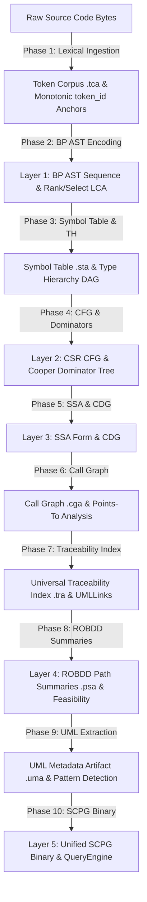
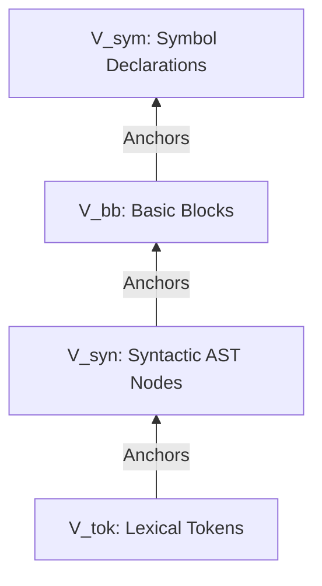
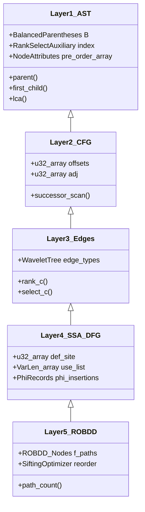
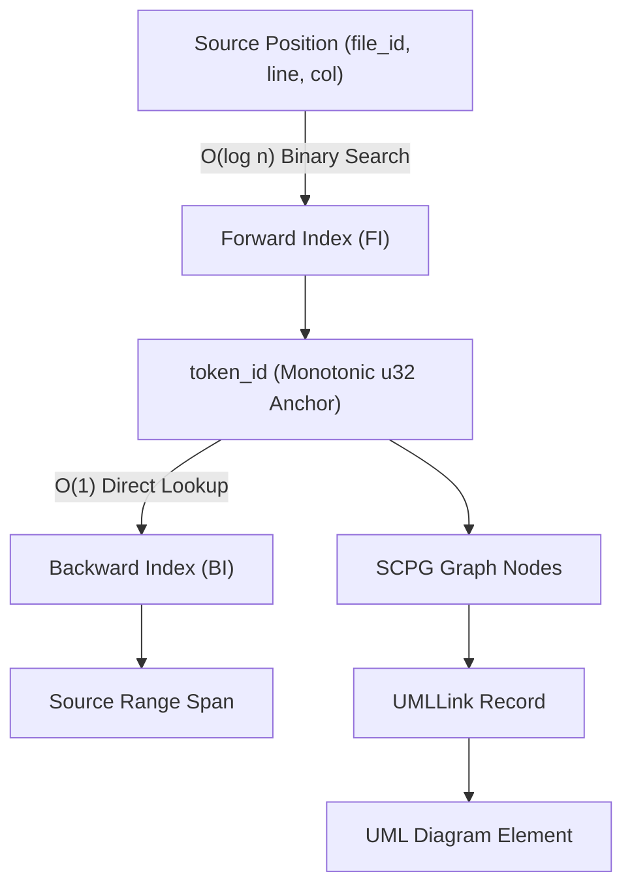
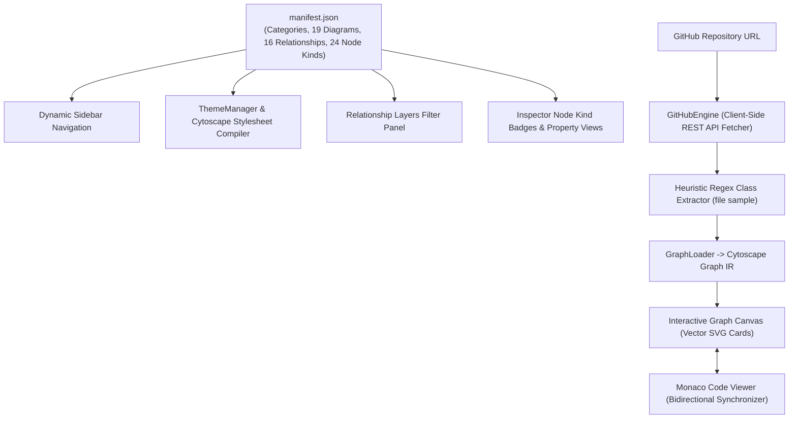

# Succinct Compositional Program Graph (SCPG) — Architecture Specification

> **Status.** This page describes the SCPG *architecture as designed*. Several layers below were not implemented, or were implemented differently, at the audited baseline `fc218cd`; each such place carries an *Implementation* note. The authoritative per-phase status is **[status.md](./status.md)**.

## 1. System Philosophy & Architectural Vision

The **Succinct Compositional Program Graph (SCPG)** is a static program-analysis graph and UML generation design created and maintained by **Ahmad Hassan (B-Ted)**.

👉 **[Launch OpenHeart Web Studio Portal (GitHub Pages)](https://ahmadhassan-bted.github.io/OpenHeart/)**

The design unifies Abstract Syntax Trees (AST), Control Flow Graphs (CFG), Data Flow Graphs (DFG), Call Graphs (CG) and Type Hierarchies (TH) into one array-based graph representation anchored to source tokens. Compactness and memory-mapped access are design goals; neither has been measured for the reference implementation (see the [claims ledger](./status.md#6-claims-ledger)).

---

## 2. Formal Mathematical Definition of SCPG

Formally, an SCPG is defined as a 7-tuple:

$$\mathcal{G} = (V, E, \nu, \varepsilon, \tau, \rho, \Sigma_\Phi)$$

### 2.1 Vertex Partition & Subsumption Lattice

The finite vertex set $V$ is partitioned into five disjoint sub-domains:

$$V = V_{\text{tok}} \sqcup V_{\text{syn}} \sqcup V_{\text{bb}} \sqcup V_{\text{ssa}} \sqcup V_{\text{sym}}$$

- $V_{\text{tok}}$: Lexical tokens scanned from source files (AST leaves).
- $V_{\text{syn}}$: Syntactic AST internal nodes.
- $V_{\text{bb}}$: Basic blocks (maximal straight-line code sequences).
- $V_{\text{ssa}}$: Variable definitions in Static Single-Assignment (SSA) form.
- $V_{\text{sym}}$: Symbol declarations (functions, classes, interfaces, fields, packages).

The layers are disjoint; each is **anchored** in the layers below it (every AST node spans a token range, every block a statement sub-sequence, every symbol a declaration node):

Anchoring gives every entity a source range. Backward projection (entity → source) is an O(1) dense-array lookup; forward projection (source → entities) is a search over a sorted span index.

### 2.2 Typed Edge Alphabet ($\Sigma_E$)

The edge set $E \subseteq V \times V \times \Sigma_E$ encompasses specialized sub-graphs:

$$\Sigma_E = \{ \text{AST\_CHILD}, \text{CFG\_TRUE}, \text{CFG\_FALSE}, \text{CFG\_UNCOND}, \text{DFG\_DEF}, \text{DFG\_USE}, \text{CDG\_TRUE}, \text{CDG\_FALSE}, \text{CG\_CALL}, \text{CG\_RETURN}, \text{TH\_EXTENDS}, \text{TH\_IMPLEMENTS}, \text{TH\_USES} \}$$

---

## 3. The 5-Layer Succinct Storage Engine

### 3.1 Layer 1 — AST via Balanced Parentheses (BP)
- Encodes tree hierarchy into a parenthesis bit sequence $B \in \{(, )\}^{2n_{\text{ast}}}$.
- **Design**: Sadakane/Munro–Raman o(n)-bit auxiliary structures supporting O(1) `findopen`, `findclose`, `enclose`, `parent`, `first_child`, `next_sibling`, `subtree_size` and `LCA`.
- **Implementation (audited baseline `fc218cd`)**: a `u32` jump-table entry per BP position (`src/ast/jump_table.rs`), a rank directory (`src/ast/rank_select.rs`), preorder attribute arrays and `parent_map` (`src/ast/preorder.rs`), and a full sparse-table RMQ over the excess sequence (`src/ast/rmq.rs`). This is O(n log n) words, not 2n + o(n) bits, and `select1` scans bit by bit. No memory figure has been measured; the earlier "~4.65 MB per 1M nodes, 6.9× smaller" figure is withdrawn.

### 3.2 Layer 2 & 3 — CFG via Compressed Sparse Row (CSR) & Typed Edges
- Stores control flow adjacencies in packed arrays `offsets[0..n_bb]` and `adj[0..m_cfg]` (implemented in `src/cfg/`).
- **Design (planned)**: edge types $\Sigma_E$ encoded in a Wavelet Tree for $O(\log \sigma)$ type-filtered edge enumeration. No wavelet tree exists in the code; edge kinds are stored per edge.

### 3.3 Layer 4 — SSA Form and DFG Encoding
- Static Single-Assignment (SSA) conversion using iterated dominance frontiers ($\phi$-functions).
- Variable definitions indexed directly in $O(1)$ by variable ID; use lists stored in variable-length byte buffers.

### 3.4 Layer 5 — ROBDD Path Summaries
- **Design**: encode the entry-to-exit paths of each function as a Boolean function $f_{\text{paths}}$ in an ROBDD, so that #SAT equals the number of paths and is computable in $O(|\text{ROBDD}|)$; refine the variable order with Rudell's sifting.
- **Implementation (audited baseline `fc218cd`)**: ROBDD library with unique table, apply, restrict and sat-count (`src/psa/bdd/`), and FORCE ordering (`src/psa/ordering/force.rs`). The path constraints leave the edges of unreached blocks free and have no exit constraint, so #SAT overstates the number of paths for branching functions. The sifting pass permutes the ordering table without rewriting the BDD, so it has no effect. Complement edges are not implemented.

---

## 4. Source Traceability Protocol

The traceability system relies on a monotonic 32-bit `token_id` assigned during Phase 1 lexical scanning that acts as the anchor across all 5 layers. The forward query below is designed as a binary search followed by an output-sensitive walk; at the audited baseline `fc218cd` the implementation scanned after the binary search, so it was not O(log n + k).

---

## 5. 19-View Derivation Matrix

The *Primary SCPG Source Layer* column is the design. The *Status* column is the implementation at the audited baseline `fc218cd`; the reasons are in [status.md §5](./status.md#5-diagram-provenance-matrix).

| # | Diagram Name | Category | Primary SCPG Source Layer (design) | Extractor / Serializer Module | Cytoscape Layout Engine | Status |
|---|---|---|---|---|---|---|
| 01 | **Class Diagram** | UML Structural | $E^{\text{TH}}$ (Type Hierarchy) + $V_{\text{sym}}$ | `uma/structural/class_diagram.rs` | `package_tree` | Partial |
| 02 | **Package Diagram** | UML Structural | $V_{\text{sym}}$ Package Tree & Namespace Bounds | `uma/structural/package_diagram.rs` | `hierarchical` | Partial |
| 03 | **Component Diagram** | UML Structural | $V_{\text{sym}}$ Subsystem & Service Wiring | `uma/structural/component_diagram.rs` | `hierarchical` | Partial |
| 04 | **Composite Structure** | UML Structural | Internal Field Symbols & Port Connectors | `uma/structural/composite_diagram.rs` | `hierarchical` | Not derived |
| 05 | **Object Diagram** | UML Structural | $E^{\text{TH}}$ + SSA Heap Instance Links | `uma/structural/object_diagram.rs` | `hierarchical` | Not derived |
| 06 | **Deployment Diagram** | UML Structural | Node Artifacts & Hardware Execution Targets | `scpg/diagram/export/json.rs` | `hierarchical` | Partial |
| 07 | **Profile Diagram** | UML Structural | Metamodel Stereotypes & Tagged Values | `scpg/diagram/export/json.rs` | `hierarchical` | Template |
| 08 | **Sequence Diagram** | UML Behavioral | $E^{\text{CG}}$ (Call Graph) + Lifeline Traces | `uma/behavioral/sequence_diagram.rs` | `sequence` | Partial |
| 09 | **State Machine Diagram** | UML Behavioral | $E^{\text{CFG}}$ + State Transition Traversal | `uma/behavioral/state_machine.rs` | `hierarchical` | Template |
| 10 | **Activity Diagram** | UML Behavioral | $E^{\text{CFG}}$ + CDG Dominance Branches | `uma/behavioral/activity_diagram.rs` | `hierarchical` | Partial |
| 11 | **Use Case Diagram** | UML Behavioral | Public API Surface Boundaries & Actors | `uma/actor_identification.rs` | `usecase` | Partial |
| 12 | **Communication Diagram** | UML Behavioral | $E^{\text{CG}}$ Topology + Sequenced Numbers | `uma/behavioral/communication_diagram.rs` | `hierarchical` | Not derived |
| 13 | **Interaction Overview** | UML Behavioral | Nested Sequence Reference Frames (`ref sd`)| `uma/behavioral/interaction_overview.rs` | `hierarchical` | Not derived |
| 14 | **Timing Diagram** | UML Behavioral | Multi-Track Waveforms & Temporal Bounds | `uma/behavioral/timing_diagram.rs` | `timing` | Template |
| 15 | **Control Flow Graph (CFG)** | Compiler IR | $V_{\text{bb}}$ Basic Blocks + CSR Adjacency | `scpg/diagram/export/json.rs` | `hierarchical` | Template |
| 16 | **Data Flow Graph (DFG)** | Compiler IR | SSA Def-Use Chains & Lineage Vectors | `scpg/diagram/export/json.rs` | `hierarchical` | Template |
| 17 | **Control Dependence (CDG)** | Compiler IR | Reversed Post-Dominance Frontiers | `scpg/diagram/export/json.rs` | `hierarchical` | Template |
| 18 | **Call Graph (CG)** | Compiler IR | Interprocedural Call Sites & CHA Dispatch | `scpg/diagram/export/json.rs` | `hierarchical` | Template |
| 19 | **ROBDD Saturation** | Compiler IR | Canonical BDD Graphs & #SAT Path Counts | `scpg/diagram/export/json.rs` | `hierarchical` | Template |

---

## 6. Declarative Manifest & Zero-Backend Web Studio Architecture

The OpenHeart Web Studio is a static site hosted on GitHub Pages. Its in-browser repository analysis is **independent of the Rust engine**: `GitHubEngine` finds classes with regular expressions, falls back to classes derived from file names, and reads only a sample of files (see [status.md §3](./status.md#3-entry-points-and-input-selection)). Running `openheart server` locally serves the same studio backed by the full Rust pipeline.

- **Manifest-Driven Configuration**: Centralized `web/diagrams/manifest.json` defines all terminology, badge colors, layout algorithms, and relationship semantics without hardcoding.
- **Dynamic Cytoscape Stylesheet Compiler**: `ThemeManager` compiles Cytoscape edge styles and arrowheads dynamically based on the active theme (Obsidian Dark or Swiss Light).
- **In-Browser GitHub Engine**: Fetches a sample of a public GitHub repository's files through the unauthenticated GitHub REST API (60 requests per hour) and extracts classes heuristically. Its results are a preview, not engine output.
