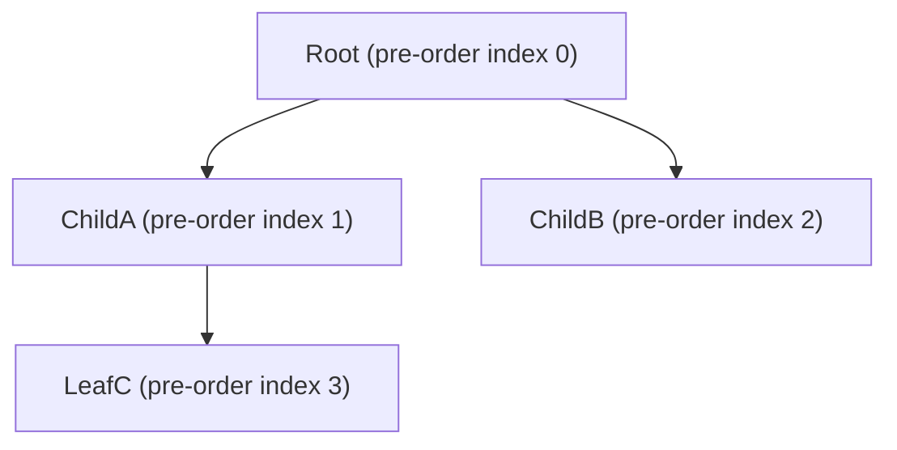

# Succinct Data Structures & Complexity Bounds in SCPG

This document details the algorithms, succinct representations and complexity bounds that the **Succinct Compositional Program Graph (SCPG)** design builds on, and states for each one what the reference implementation actually stores.

> **Status.** Textbook bounds below are properties of the cited structures. They become properties of OpenHeart only where the *Implementation* notes say so. No space or time figure in this document has been measured on OpenHeart; the measurement protocol is in [status.md §7](./status.md#7-measurement-protocol).

👉 **[Launch OpenHeart Web Studio Portal (GitHub Pages)](https://ahmadhassan-bted.github.io/OpenHeart/)**

---

## 1. AST Encoding via Balanced Parentheses (BP)

### 1.1 Structural Theorem (Munro & Raman, 1997; Sadakane & Navarro, 2014)

An ordered tree of $n$ nodes can be represented as a sequence of $2n$ balanced parentheses $B \in \{(, )\}^{2n}$ generated by a depth-first traversal:
- Emit `(` on first visit (pre-order entry).
- Emit `)` on backtrack (post-order exit).

### 1.2 Auxiliary Rank/Select Operations

With an auxiliary structure of $o(n)$ bits (for example a range min-max tree), the following queries run in **O(1)** (or O(log n) in the simpler practical variants):

| Query Operation | Mathematical Definition | Computational Meaning |
|---|---|---|
| `rank_((B, i)` | $\sum_{j=1}^i [B[j] = '(']$ | Number of open parentheses up to index $i$. |
| `select_((B, k)` | $\min \{ i \mid \text{rank}_((B, i) = k \}$ | Bit position of the $k$-th open parenthesis. |
| `findclose(B, i)` | Matching `)` for `(` at position $i$ | Locates end of subtree rooted at node $i$. |
| `findopen(B, i)` | Matching `(` for `)` at position $i$ | Locates start of subtree. |
| `enclose(B, i)` | Smallest matching pair enclosing $i$ | Computes `parent(v)`. |
| `lca(u, v)` | Minimum excess range query in $B[\text{pre}(u)..\text{pre}(v)]$ | Computes Lowest Common Ancestor. |

### 1.3 Space: Textbook Bound versus the Implemented Layout

**Textbook bound.** The BP sequence takes $2n$ bits, and a range min-max tree adds $o(n)$ bits, for $2n + o(n)$ bits of topology. For $n = 1{,}000{,}000$ nodes the topology is about 250 KB plus lower-order terms. Per-node payload (node type, token range) is extra and is the same for any encoding: one `u8` type and two `u32` token bounds are 9 bytes per node, or 9 MB at $n = 10^6$. Against a 32-byte pointer node, the topology alone shrinks by up to $256/2 = 128\times$, but once the 9 bytes of payload are included the whole node shrinks by roughly $3.3\times$. **The 128× figure is a ratio of topology encodings, not of total memory, and has never been measured on OpenHeart.**

**Implemented layout at the audited baseline `fc218cd`** (`src/ast/`):

| Structure | File | Size as a function of $n$ AST nodes |
|---|---|---|
| BP bitstring | `bp_encoder.rs` | $2n$ bits |
| Jump table (matching position for every BP position) | `jump_table.rs` | one `u32` per BP position: $2n$ words |
| Rank directory | `rank_select.rs` | block counters over the bitstring: $\Theta(n)$ bits, not $o(n)$ |
| Preorder arrays (node attributes, token ranges, `parent_map`) | `preorder.rs` | a fixed number of bytes per node: $\Theta(n)$ bytes |
| Sparse-table RMQ over the excess sequence | `rmq.rs` | $\lceil \log_2 2n \rceil$ levels of `u32` over $2n$ positions plus side arrays: $\Theta(n \log n)$ words |

The sparse table dominates, so the implemented AST is $\Theta(n \log n)$ words — larger than a 32-byte pointer tree for large $n$, not smaller. On disk, the `.bpa` stores the bitstring and preorder arrays, and the reader rebuilds the jump table, rank directory and sparse table on every load. `select1` is implemented as a bit-by-bit scan, so operations that depend on it are linear in the worst case.

**Path to the textbook bound.** Replace the jump table and sparse table with a range min-max tree (Navarro & Sadakane, ACM TALG 2014), use a rank/select scheme with $o(n)$ overhead (for example rank9/select9 or Elias–Fano), and derive `parent` from the BP sequence instead of storing `parent_map`. A bits-per-node figure may then be published once suite S15 measures it.

---

## 2. Compressed Sparse Row (CSR) & Typed Edges

### 2.1 CSR Adjacency Representation *(implemented)*

For a graph with $n$ basic blocks and $m$ edges, CSR stores graph structure in two contiguous arrays:
- `offsets[0..n]`: Cumulative out-degree prefix sum (`offsets[v]` is the starting index of block $v$'s edges).
- `adj[0..m-1]`: Target vertex IDs for all edges.

Iterating the successors of block $v$ scans `adj[offsets[v]..offsets[v+1]-1]` sequentially.

### 2.2 Wavelet Tree Edge Filtering *(planned — not implemented)*

Given an edge type alphabet $\Sigma_E$ with $|\Sigma_E| = \sigma = 16$, edge types could be stored in a Wavelet Tree over `etype[0..m-1]`:
- $m \lceil \log_2 \sigma \rceil = 4m$ bits plus rank/select overhead.
- `range_count(v_start, v_end, target_type)` counts the outgoing edges of one type in $O(\log \sigma)$ steps.
- No separate adjacency array per edge type is needed.

At the audited baseline `fc218cd` no wavelet tree existed in `src/`; the code stored an edge kind per edge.

---

## 3. Deduplicated 64-bit FNV-1a String Interner *(implemented)*

### 3.1 Hash Function Formula

$$\text{hash}_0 = \text{0xcbf29ce484222325}$$
$$\text{hash}_{k} = (\text{hash}_{k-1} \oplus \text{byte}_k) \times \text{0x00000100000001B3} \pmod{2^{64}}$$

### 3.2 Open-Addressing Probe & Amortized Complexity

- Open-addressing table with linear probing at load factor limit $\alpha = 0.75$.
- Under the uniform-hashing assumption, the expected probe count for an unsuccessful lookup with linear probing is $\frac{1}{2}\left(1 + \frac{1}{(1-\alpha)^2}\right) = 8.5$ at $\alpha = 0.75$, and $\frac{1}{2}\left(1 + \frac{1}{1-\alpha}\right) = 2.5$ for a successful one (Knuth, TAOCP Vol. 3, §6.4). These are analytical expectations, not measurements.
- Contiguous storage: `storage: Vec<u8>` holding `[u16_len][utf8_bytes...]`, indexed by a parallel offset vector `offsets: Vec<u32>`.
- **Lookup complexity**: $O(|text|)$ expected time; $O(1)$ text retrieval by `text_id`.

---

## 4. Reduced Ordered Binary Decision Diagrams (ROBDD)

### 4.1 Shannon Expansion Definition

For a Boolean function $f(x_1, x_2, \dots, x_m)$:

$$f = (\bar{x}_1 \land f_{x_1=0}) \lor (x_1 \land f_{x_1=1})$$

An ROBDD represents $f$ as a directed acyclic graph with:
1. A fixed variable ordering.
2. Isomorphic sub-graphs merged.
3. Redundant nodes (identical low and high children) eliminated.

### 4.2 Path Counting

**Design.** If $f_{\text{paths}}$ is true exactly on the assignments that select the edge set of one entry-to-exit path, then $\#\text{SAT}(f_{\text{paths}})$ equals the number of paths and is computed in $O(|\text{ROBDD}|)$ by a memoised traversal. For that to hold, the constraints must (a) force every edge out of an unreached block to 0, (b) allow at most one selected edge into and out of every block, and (c) require exactly one selected edge out of the entry and into the exit.

**Implementation at the audited baseline `fc218cd`** (`src/psa/construction/constraints.rs`). The constraint for a block only states "if the block is reached, its outgoing edges satisfy the branch constraint". Edges of unreached blocks stay free and there is no exit constraint, so #SAT counts many assignments that are not paths and overstates the path count of every branching function. Independently of ROBDDs, the number of acyclic entry-to-exit paths can be counted exactly in $O(V + E)$ with Ball–Larus path numbering (MICRO 1996), with loops reported separately.

### 4.3 Dynamic Sifting Optimization (Rudell, 1993)

**Design.** Rudell's sifting reorders variables to reduce BDD size:
1. Select variable $x_i$.
2. Swap $x_i$ with adjacent variables, in place, to move it through every position in the order.
3. Record the live BDD node count at each position.
4. Move $x_i$ to the position with the minimum count.

Each adjacent swap rewrites only the nodes at the two levels involved.

**Implementation at the audited baseline `fc218cd`** (`src/psa/ordering/sifting.rs`). The pass permutes the ordering table but never rewrites any BDD node, and it measures a node count that the permutation cannot change. It therefore always returns each variable to its starting position and has no effect.

---

## 5. Summary Complexity Bounds

| Sub-System | Design bound | Implemented (audited baseline `fc218cd`) |
|---|---|---|
| **Phase 1 Ingestion** | $O(N + n_{\text{tok}} \log n_{\text{tok}})$ time, $O(n_{\text{tok}})$ space | As designed (not benchmarked). |
| **BP Tree Navigation** | $O(1)$ per operation, $2n_{\text{ast}} + o(n_{\text{ast}})$ bits | O(1) rank, parent, match and LCA; `select1` linear; $\Theta(n \log n)$ words (§1.3). |
| **CSR Edge Enumeration** | $O(\text{outdeg}(v))$, $4n_{\text{bb}} + 4m_{\text{cfg}}$ bytes | As designed. |
| **Wavelet Edge Filter** | $O(\log \sigma)$, $m \log_2 \sigma$ bits | Not implemented. |
| **ROBDD Path Count (#SAT)** | $O(|\text{ROBDD}|)$ time | Runs in $O(|\text{ROBDD}|)$, but the encoded function is not the path function (§4.2), so the count is an overestimate. |
| **Forward Source Lookup** | $O(\log n_{\text{tok}} + k)$ | Binary search followed by a scan. |
| **Backward Source Lookup** | $O(1)$ array dereference | As designed. |
