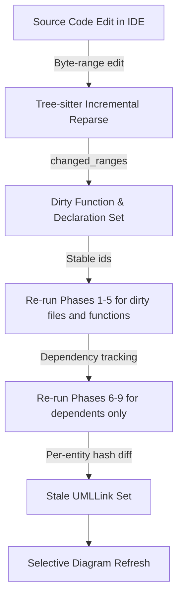

# Traceability & Incremental Synchronization

This document specifies the bidirectional traceability mechanism of the **Succinct Compositional Program Graph (SCPG)** (§1–§2, implemented in Phase 7) and the incremental synchronization design (§3, **not implemented**).

> **Status.** Per-phase implementation status is recorded in [status.md](./status.md). In short: the `token_id` anchor and the dense backward indexes are implemented; forward-query complexity is tracked in the [phase capability ledger](./status.md#4-phase-capability-ledger); at the audited baseline `fc218cd` no part of the incremental protocol in §3 existed in the code, and every analysis run recomputed all ten phases from scratch.

---

## 1. Monotonic `token_id` Traceability Anchor

Every lexical token generated during Phase 1 ingestion is assigned a unique, monotonically increasing 32-bit identifier:

$$\text{token\_id} \in \mathbb{N}, \quad 0 \le \text{token\_id} < n_{\text{tok}}$$

This `token_id` is the **traceability anchor**. Later phases store token ranges `[first_token_id, last_token_id]` instead of positions, and never reassign a `token_id`.

```mermaid
graph TD
    Scanner["Lexical Scanner (Phase 1)"] -->|Assigns monotonic token_id: u32| AST["AST Nodes (Phase 2)"]
    AST -->|Token ranges [first_token_id, last_token_id]| SYM["Symbols (Phase 3)"]
    AST -->|Statement token spans| BB["Basic Blocks (Phase 4)"]
    BB -->|Defining statement spans| SSA["SSA Definitions (Phase 5)"]
    SYM -->|Declaration spans| UML["UML Diagram Elements (Phase 9)"]
    UML -->|UMLLinkRecord| Anchor["Source Range Span"]
```

`token_id`s are numbered across the whole corpus, not per file. Inserting one token in an early file therefore shifts the id of every later token; this is the main obstacle to the incremental design in §3.

---

## 2. Forward and Backward Traceability Indices

The record layouts are defined in `src/tra/types.rs`; this section describes their roles.

### 2.1 Backward Index (Entity → Source Range) — implemented
- One dense array per layer, indexed directly by the entity id: AST nodes by preorder index, symbols by `sym_id`, basic blocks by global block id, SSA definitions by global SSA index, call sites by `call_site_id`.
- Each entry stores the entity's first and last `token_id`; the token records give file, line and column.
- **Lookup complexity**: one array read plus one token-record read, **O(1)**.

### 2.2 Forward Index (Source Position → Entities)
- **Position → token**: Phase 1's token records are sorted by the packed key
  $$\text{key} = (\text{file\_id} \ll 48) \mid (\text{line} \ll 24) \mid (\text{col} \ll 8)$$
  so a position is located by `lower_bound` binary search in $O(\log n_{\text{tok}})$.
- **Token → enclosing entities**: symbol and call-site span records sorted by `(file_id, first_token_id)`. A stabbing query returns every span containing the token.
- **Design target**: $O(\log n + k)$ for $k$ results, by binary-searching the innermost enclosing span and walking enclosing-span links outward. An implementation that scans backwards from the binary-search position until the file changes costs $O(\log n + s)$, where $s$ is the number of spans earlier in the same file; which of the two the code currently achieves is recorded in [status.md §4](./status.md#4-phase-capability-ledger).

### 2.3 `UMLLinkRecord`

Every UML-relevant symbol gets a precomputed 24-byte link record (`UMLLinkRecord` in `src/tra/types.rs`):

```rust
#[repr(C)]
pub struct UMLLinkRecord {
    pub sym_id: u32,
    pub file_id: u16,
    pub line_start: u32,
    pub col_start: u16,
    pub line_end: u32,
    pub col_end: u16,
    pub scpg_hash: u32,   // build tag shared by every link of one build
    pub sym_kind: u8,
    pub _reserved: [u8; 3],
}
```

`scpg_hash` is a whole-build tag derived from the upstream artifact checksums. Because it changes on any edit, comparing it alone marks **every** link stale after any change; per-element staleness requires a per-entity hash, which is part of the design in §3.

---

## 3. Incremental Synchronization Engine — *Design, Not Implemented*

At the audited baseline `fc218cd` nothing in this section existed in the code, and the modules that carry its names were stubs. The section is implemented only when the acceptance criterion in §3.3 is met.

| Module | What it did at the audited baseline |
|---|---|
| `src/scpg/incremental/` | Classifies a caller-supplied delta (a file id and three booleans) and returns the current hash XOR a constant; reports zero stale links. Nothing calls it. |
| `src/tra/delta/` | Compares backward-index entries by positional `sym_id` and corpus-global token ids. It has no callers, misses deletions, and an early insertion invalidates almost everything after it. |
| `src/ingestion/parser/tree_sitter.rs` | Parses every file from scratch; no previous tree is passed to tree-sitter. |

### 3.1 Prerequisites

The protocol below cannot be sound until these exist:

1. **Stable identities.** File-local token and node ids (for example `(file_id, local_index)`) and symbol keys derived from qualified name plus signature, so that an edit in one file renumbers nothing in another.
2. **Per-file caches** of Phase 1–5 outputs keyed by a content hash of the file and the configuration.
3. **Dependency tracking** between phases (demand-driven, Salsa-style revisions with early cut-off), so that a change is propagated only to the functions, classes and callers that depend on it.
4. **Edit-derived deltas**: tree-sitter `Tree::edit` plus `changed_ranges` to find dirty functions, instead of caller-asserted flags.

### 3.2 Target Protocol



1. **Incremental reparse**: tree-sitter re-parses only the edited region, given the previous tree and the edit.
2. **Dirty-set identification**: `changed_ranges` mapped to the enclosing functions and declarations.
3. **Partial recomputation**: CFG, SSA and ROBDD summaries recomputed **only for affected functions**; symbol and call-graph updates limited to changed declarations and their dependents.
4. **Staleness**: a per-entity hash compared with the hash stored at diagram generation time identifies exactly the stale diagram elements.
5. **Selective refresh**: only those diagram elements are re-rendered.

**Change classification.** A comment or whitespace edit is *not* free: it moves the line and column of every later token in the file, so token positions and source spans must be re-indexed even though no semantic phase needs to re-run. Only edits that move no offsets need no work.

> **Example (target behaviour)**: modifying a private method body recomputes the CFG, SSA and ROBDD summary of that one method and the positions of the tokens after the edit in that file. Class boxes, package structures and unrelated sequence diagrams remain untouched.

### 3.3 Acceptance Criterion

The design is implemented when an edit-replay benchmark over real commit histories shows that incremental results are byte-identical to a clean rebuild, and reports the recomputed fraction and the latency per edit.
