# SCPG Diagram Suite — Derivation Specification (19 View Types)

This document defines the mappings, query formulas and derivation rules by which the **14 UML view types** and **5 compiler-IR views** are to be generated from the **Succinct Compositional Program Graph (SCPG)**.

> **Status.** The rules below are the *design*. Each view carries an **Implementation** note stating what the code did at the audited baseline `fc218cd`; the consolidated table is the [diagram provenance matrix](./status.md#5-diagram-provenance-matrix). No view is checked for UML 2.5 conformance, and no behavioural view is validated against program executions. Views marked *Template* or *Not derived* must not be read as describing the analysed program.

---

## 1. Classification & Sub-Graph Mapping Matrix

```mermaid
graph TD
    SCPG["Succinct Compositional Program Graph (SCPG)"] --> Structural["1. UML Structural (7)"]
    SCPG --> Behavioral["2. UML Behavioral (7)"]
    SCPG --> CompilerIR["3. Compiler Pipeline IRs (5)"]

    subgraph Structural_Views["UML Structural Projections"]
        Structural --> D1["01 · Class Diagram (E^TH + V_sym)"]
        Structural --> D2["02 · Package Diagram (V_sym Namespaces)"]
        Structural --> D3["03 · Component Diagram (V_sym Modules)"]
        Structural --> D4["04 · Composite Structure (Parts & Ports)"]
        Structural --> D5["05 · Object Diagram (Allocation Sites + Points-To)"]
        Structural --> D6["06 · Deployment Diagram (Deployment Metadata)"]
        Structural --> D7["07 · Profile Diagram (Stereotype Records)"]
    end

    subgraph Behavioral_Views["UML Behavioral Projections"]
        Behavioral --> D8["08 · Sequence Diagram (E^CG + CFG Order)"]
        Behavioral --> D9["09 · State Machine (State Fields + Guards)"]
        Behavioral --> D10["10 · Activity Diagram (E^CFG + CDG Branches)"]
        Behavioral --> D11["11 · Use Case Diagram (API Surface + Actors)"]
        Behavioral --> D12["12 · Communication Diagram (E^CG + Ordinals)"]
        Behavioral --> D13["13 · Interaction Overview (CFG + Ref Frames)"]
        Behavioral --> D14["14 · Timing Diagram (Illustrative)"]
    end

    subgraph Compiler_Views["Compiler Pipeline IR Projections"]
        CompilerIR --> D15["15 · Control Flow Graph (V_bb + CSR CFG)"]
        CompilerIR --> D16["16 · Data Flow Graph (SSA Def-Use Lineage)"]
        CompilerIR --> D17["17 · Control Dependence (Post-Dominance)"]
        CompilerIR --> D18["18 · Call Graph (CHA Virtual Dispatch)"]
        CompilerIR --> D19["19 · ROBDD (Path Summary Nodes)"]
    end
```

---

## 2. Structural Diagrams Derivation Rules

### 2.1 Class Diagram (01)
- **Vertices**: $v \in V_{\text{sym}}$ where $\text{kind}(v) \in \{ \text{CLASS}, \text{INTERFACE}, \text{ENUM}, \text{RECORD}, \text{TRAIT}, \text{STRUCT} \}$.
- **Attributes & Operations**: Extracted from child nodes of $v$ in $V_{\text{sym}}$ with normalized visibility modifiers (`+`, `-`, `#`, `~`).
- **Edges**:
  - Generalization (`--|>`): $(u, v) \in E^{\text{TH}}$ with label `TH_EXTENDS`.
  - Realization (`..|>`): $(u, v) \in E^{\text{TH}}$ with label `TH_IMPLEMENTS`.
  - Association (`-->`): Fields in class $u$ referencing classifier $v$.
  - Aggregation (`o--`): Collection fields in class $u$ containing classifier $v$.
  - Composition (`*--`): Final/owned fields in class $u$ holding classifier $v$.
- **Implementation at the audited baseline `fc218cd` — Partial.** `src/uma/structural/class_diagram.rs`. Classes whose names appear in a built-in name list are dropped, as are names ending in `Binding`, all-caps names and some lowercase names; exporters match referenced types by simple name, which is wrong when simple names collide across packages. Generic, array and qualified field types are not resolved (Phase 3), so many associations are missing. Edge order follows hash iteration.

### 2.2 Package Diagram (02)
- **Vertices**: Package namespace nodes $v \in V_{\text{sym}}$ where $\text{kind}(v) = \text{PACKAGE}$.
- **Edges**: Inter-package dependencies $(u, v)$ where types in package $u$ reference types in package $v$ (from type references and call edges), with dependency cycles found by Tarjan SCC and Martin's metrics (Ca, Ce, I, A, D) per package.
- **Implementation at the audited baseline `fc218cd` — Partial.** `src/uma/structural/package_diagram.rs` records containment and class/sub-package counts only. No dependency edges, cycles or metrics are computed.

### 2.3 Component Diagram (03)
- **Vertices**: Components derived from build and module metadata — Maven/Gradle modules, JPMS `module-info.java`, and dependency-injection beans (`@Component`, `@Service`).
- **Interfaces**: Provided interfaces (implemented interfaces) and required interfaces (injected interface-typed fields).
- **Implementation at the audited baseline `fc218cd` — Partial.** `src/uma/structural/component_diagram.rs` makes one component per package. Provided interfaces are counted as interfaces declared in the package and required interfaces as type-hierarchy edges to outside interfaces (duplicates included); exporters render neither. No build or module metadata is read.

### 2.4 Composite Structure Diagram (04)
- **Vertices**: Classifiers with internal structured parts and port pins (`port_in`, `port_out`).
- **Edges**: Assembly connectors (`-(0-`) wiring collaborating internal parts.
- **Implementation at the audited baseline `fc218cd` — Not derived.** `src/uma/structural/composite_diagram.rs` has an empty body.

### 2.5 Object Diagram (05)
- **Vertices**: Abstract objects at allocation sites, from a points-to analysis.
- **Links**: Field points-to relations between abstract objects.
- **Implementation at the audited baseline `fc218cd` — Not derived.** `src/uma/structural/object_diagram.rs` looks up symbols with SSA `orig_sym_id` values that are AST node indexes, so its objects are arbitrary symbol hits; no exporter reads `uma.objects`, and object records are not serialized.

### 2.6 Deployment Diagram (06)
- **Vertices**: Execution environments, devices and distribution artifacts (`.jar`, `.so`, `.wasm`), derived from Dockerfile, compose, Kubernetes or Helm manifests and build output declarations; the view is reported as unavailable when no such metadata exists.
- **Edges**: Manifestation (`..>`) and communication deployment links.
- **Implementation at the audited baseline `fc218cd` — Partial.** The deployment view reuses the package records. No deployment metadata is read.

### 2.7 Profile Diagram (07)
- **Vertices**: Metamodels, stereotypes (`<<stereotype>>`) and tagged value attributes, from annotation type declarations.
- **Edges**: Extension (`--|>`) of standard UML metaclasses.
- **Implementation at the audited baseline `fc218cd` — Template.** The JSON builder in `src/scpg/diagram/export/json.rs` emits constants.

---

## 3. Behavioral & Interaction Diagrams Derivation Rules

### 3.1 Sequence Diagram (08)
- **Scenarios**: One diagram per entry point (for example `main`, request-mapping handlers, test methods, framework lifecycle callbacks).
- **Lifelines**: Receiver objects participating in the scenario, named via points-to where available.
- **Messages**: Call sites inlined in CFG order with a depth bound, labelled `CG_CALL`, with replies (`CG_RETURN`) and nested activations; asynchronous starts (`Thread.start`, `Executor.submit`, `CompletableFuture`) marked as asynchronous messages.
- **Combined Fragments (alt, opt, loop, break)**: Mapped from branch and loop regions of the CFG, with guards taken from the branch condition's token span.
- **Implementation at the audited baseline `fc218cd` — Partial.** `src/uma/behavioral/sequence_diagram.rs` expands callers from a LIFO stack after all of a method's calls are emitted, so sub-calls print in the wrong order and each method is expanded once; there is no depth bound or library filter. `combined_fragments` is always empty. Exporters emit activate/return/deactivate immediately after each call, so activations never nest. All entry-point scenarios are concatenated into one diagram.

### 3.2 State Machine Diagram (09)
- **States**: Values of enum- or integer-typed state fields.
- **Transitions**: Guarded assignments to those fields in methods, with guards from the CDG and path summaries; no diagram is emitted when a class has no state variable.
- **Implementation at the audited baseline `fc218cd` — Template.** `src/uma/behavioral/state_machine.rs` ignores its SSA input and emits, for every class, an initial and a final state with one transition per method.

### 3.3 Activity Diagram (10)
- **Action Nodes**: Basic block statement nodes $v \in V_{\text{bb}}$, labelled from their statements' token spans.
- **Control Flow Edges**: $E^{\text{CFG}}$ edges labelled `CFG_TRUE`, `CFG_FALSE`, `CFG_UNCOND`, with `[cond]` / `[else]` guards and `case` labels; exception edges rendered as exception handlers.
- **Decision & Merge Nodes**: Explicit decision nodes at branching blocks and merge nodes at join points; fork/join for thread and asynchronous starts.
- **Implementation at the audited baseline `fc218cd` — Partial.** `src/uma/behavioral/activity_diagram.rs` maps every edge to a plain control edge with no guard, does not use loop information, turns switch blocks with more than two successors into actions, and produces no fork, join or exception nodes. Node labels are `Block_N`. Exporters show only the first few functions.

### 3.4 Use Case Diagram (11)
- **Actors**: External client entities derived from public entry points and API boundaries.
- **Use Cases**: Public service methods enclosed in system boundary boxes.
- **Relationships**: Association, `<<include>>` and `<<extend>>` dependencies.
- **Implementation at the audited baseline `fc218cd` — Partial.** `src/uma/actor_identification.rs` identifies actors and use cases heuristically; there is no oracle for this view.

### 3.5 Communication Diagram (12)
- **Collaborating Objects**: Instance nodes interacting within a scenario (from the sequence records and object naming).
- **Sequenced Messages**: Collaboration links annotated with invocation order numbers (`1: init()`, `2: process()`).
- **Implementation at the audited baseline `fc218cd` — Not derived.** `src/uma/behavioral/communication_diagram.rs` has an empty body.

### 3.6 Interaction Overview Diagram (13)
- **Frames**: A high-level control-flow graph whose nodes are sequence reference frames (`ref sd`).
- **Implementation at the audited baseline `fc218cd` — Not derived.** `src/uma/behavioral/interaction_overview.rs` has an empty body; the JSON builder emits constants.

### 3.7 Timing Diagram (14)
- **Tracks**: Lifelines showing state changes over time.
- **Static derivation limit**: Static analysis has no clock. A timing view derived from source can show only an ordering of events, not durations; real timing requires dynamic traces.
- **Implementation at the audited baseline `fc218cd` — Template (illustrative).** The exporters advance a fixed clock by 50 per message of the first sequence (labels such as `@0ms`, `@50ms`); when there is no sequence they fall back to the first 3 classes × 2 methods. The times do not describe the program.

---

## 4. Compiler Pipeline IR Projections Derivation Rules

All five views in this section were **templates** at the audited baseline `fc218cd`: the exporters received only the `.uma`, `.sta` and `.tca` artifacts and never read `.cfa`, `.ssa`, `.cga` or `.psa`. Rendering them from the artifacts requires passing those artifacts to the exporters; an exporter that lacks them must report the view as unavailable rather than draw a placeholder.

### 4.1 Control Flow Graph - CFG (15)
- **Basic Blocks**: Maximal straight-line instruction sequences with single entry and exit (`.cfa` block metadata).
- **Edges**: Unconditional jumps, conditional true/false branches and loop back-edges (`.cfa` successor CSR), with the dominator tree from `idom[]`.
- **Implementation at the audited baseline `fc218cd` — Template.** Every function is drawn as the same fixed entry/branch/exit shape; the JSON builder describes OpenHeart's own pipeline.

### 4.2 Data Flow Graph - DFG (16)
- **Data Nodes**: SSA definition versions ($v_0, v_1, \dots$) and φ-functions (`.ssa`).
- **Value Lineage Edges**: Def-use chains linking definitions to uses (`.ssa` def-use CSR).
- **Implementation at the audited baseline `fc218cd` — Template.** A fixed φ example (`var_name: retries`).

### 4.3 Control Dependence Graph - CDG (17)
- **Control Conditions**: Control dependences derived from post-dominance over the CFG (`.ssa` CDG CSR), labelled `CD_TRUE` / `CD_FALSE`.
- **Implementation at the audited baseline `fc218cd` — Template.** Always `(amount > 0)` → `repository.saveOrder()`.

### 4.4 Call Graph - CG (18)
- **Functions**: Method declaration nodes across the program, clustered by strongly connected component.
- **Invocations**: Static call sites and virtual dispatch resolved by Class Hierarchy Analysis (`.cga` call-edge CSR and SCC table).
- **Implementation at the audited baseline `fc218cd` — Template.** Methods are chained in hash-set order with an invented dispatch label and a fake SCC self-edge.

### 4.5 ROBDD Graph (19)
- **Decision Nodes**: The actual nodes of a function's ROBDD from `.psa`, labelled with their edge variables.
- **Terminals**: Constant $0$ and $1$ sinks, annotated with the function's path count.
- **Implementation at the audited baseline `fc218cd` — Template.** The JSON builder emits constants. Note also that the `.psa` path counts overstate the true number of paths (see [status.md §4](./status.md#4-phase-capability-ledger)).

---

## 5. Model Interchange (XMI)

- **Design**: XMI 2.5.1 (`http://www.omg.org/spec/XMI/20131001`) with UML 2.5.1 (`http://www.omg.org/spec/UML/20161101`), containing nested packages, `ownedAttribute` with type references and multiplicities, `ownedOperation`/`ownedParameter`, generalizations, interface realizations and associations with member ends, using stable ids derived from qualified names; validated by loading into Eclipse UML2 with EMF validation.
- **Implementation at the audited baseline `fc218cd` — Placeholder.** `src/scpg/diagram/export/xmi.rs` emits an XMI 2.1 document in the Eclipse UML2 3.0.0 namespace with one `uml:Class` per class named `Class_<id>` and nothing else. Neither the CLI nor the server writes XMI.

---

## 6. Query Formulas for Diagram Derivation

### 6.1 Class Hierarchy Query
To extract the complete type hierarchy for class $C$:

$$\text{Hierarchy}(C) = \{ v \in V_{\text{sym}} \mid (C, v) \in (E^{\text{TH}})^* \}$$

Evaluated by graph search over $E^{\text{TH}}$ in $O(|V_{\text{sym}}| + |E^{\text{TH}}|)$ time.

### 6.2 Interprocedural Call Sequence Query
To extract the call sequences between method $M_{\text{start}}$ and method $M_{\text{target}}$:

$$\text{Path}(M_{\text{start}}, M_{\text{target}}) = \{ \pi \in (E^{\text{CG}})^* \mid \text{first}(\pi) = M_{\text{start}} \land \text{last}(\pi) = M_{\text{target}} \land \text{feasible}(\pi, \Sigma_\Phi) \}$$

**Design**: evaluated by CFL-reachability (call/return matching) over the interprocedural supergraph. **Implementation (audited baseline `fc218cd`)**: `src/scpg/query/cfl.rs` performs plain breadth-first reachability over call edges, with no call/return matching and no feasibility check, so it answers only "is $M_{\text{target}}$ reachable from $M_{\text{start}}$ in the call graph".
